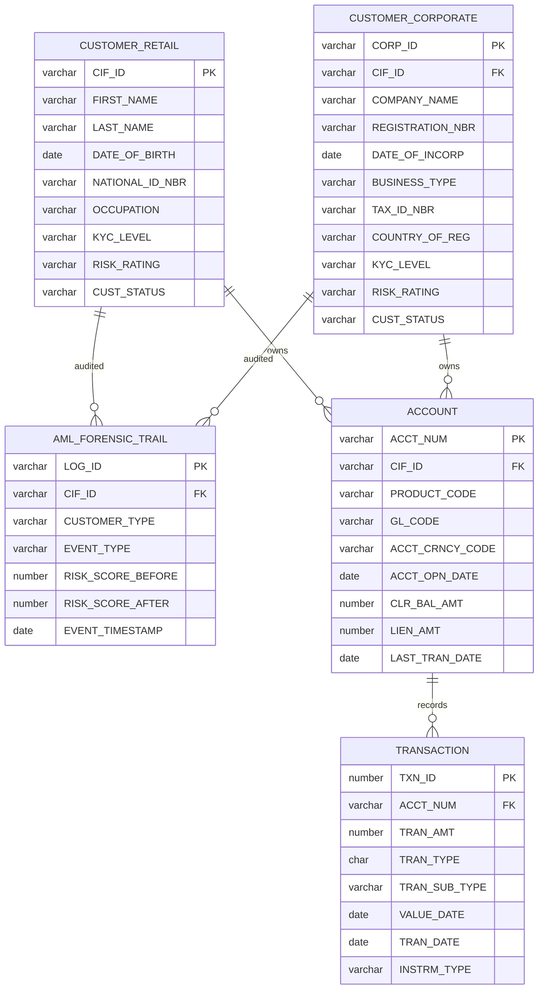
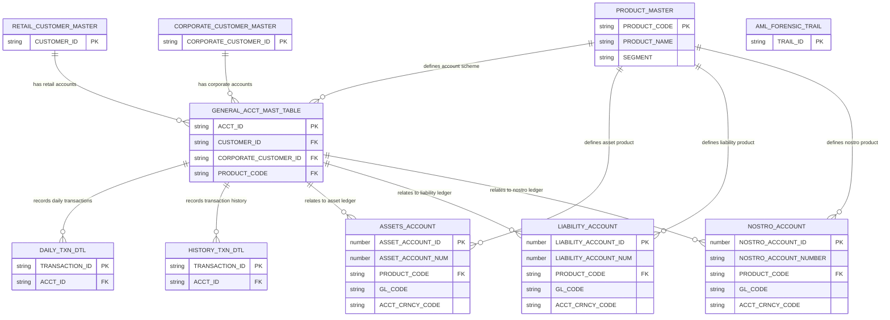

# JP Morgan Chase Commercial Banking Ledger — ER Diagram
 summarized ER_diagram view the image link [Diagram image](../images/ER_Diagram.png)

# Entity Relationship Diagram (ERD)

## Database Overview

The database consists of three schemas:

- **CUSTOMER** — customer identity and customer-related records.
- **TRANSACT** — product definitions, general account master records, and transaction records.
- **LEDGER** — internal asset, liability, and nostro account records.

## ER Diagram

## Relationship Interpretation

| Relationship | Description |
|---|---|
| Retail customer → GAM | A retail customer can hold one or more accounts in GAM. |
| Corporate customer → GAM | A corporate customer can hold one or more accounts in GAM. |
| Product master → GAM | A product or scheme, such as savings or current, can be assigned to multiple GAM accounts. |
| GAM → Daily transaction details | A GAM account can have multiple daily transaction records. |
| GAM → Transaction history | A GAM account can have multiple historical transaction records. |
| Product master → Ledger accounts | Products can be associated with asset, liability, and nostro accounts. |
| GAM → Ledger accounts | GAM is the central account master through which customer-account activity is associated with the corresponding internal ledger accounts. |

## Design Principle

The CUSTOMER schema is not directly linked to the LEDGER schema.

Customer details are maintained in the CUSTOMER schema, and customer accounts are represented in the general account master table (GAM) in the TRANSACT schema. GAM serves as the central account reference for product assignment, transaction records, and corresponding ledger-account relationships.

The ERD represents the logical model. Foreign-key columns and cardinalities should be confirmed against the final Oracle DDL.

### Notes

- **PK** = Primary Key
- **FK** = Foreign Key
- A **Customer** (Retail or Corporate) may own multiple **Accounts**.
- An **Account** may have many **Transactions**.
- AML events are tracked in **AML_FORENSIC_TRAIL** for both customer types.
- Only business-critical attributes are shown to keep the ER diagram readable.

