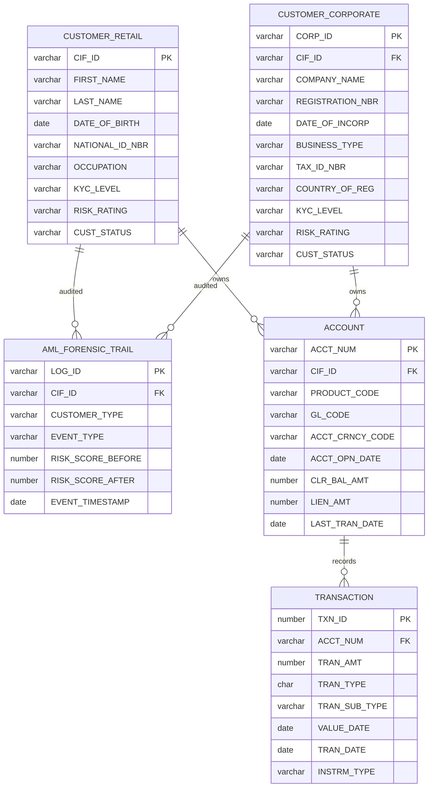

# JP Morgan Chase Commercial Banking Ledger — ER Diagram
 summarized ER_diagram view the image link [Diagram image](../images/ER_Diagram.png)

### Notes

- **PK** = Primary Key
- **FK** = Foreign Key
- A **Customer** (Retail or Corporate) may own multiple **Accounts**.
- An **Account** may have many **Transactions**.
- AML events are tracked in **AML_FORENSIC_TRAIL** for both customer types.
- Only business-critical attributes are shown to keep the ER diagram readable.

